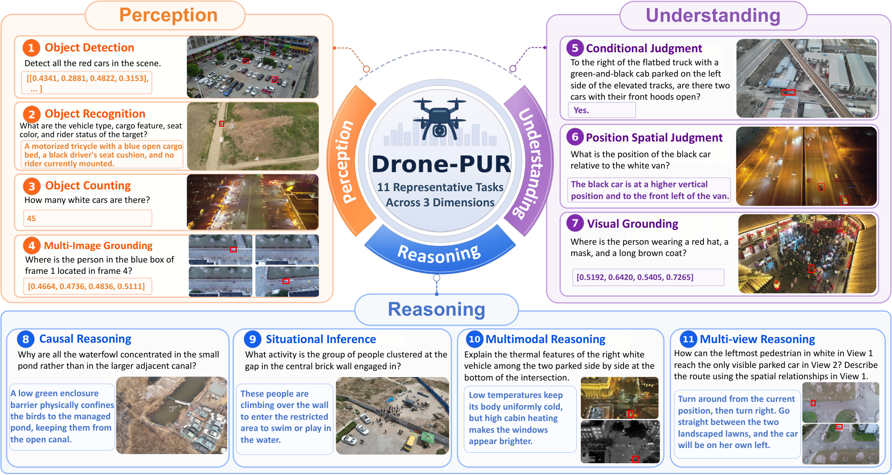
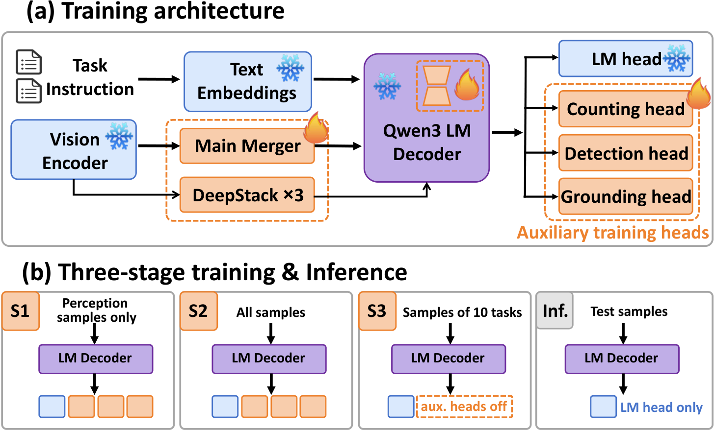

# Drone-PUR

**From Visual Clue Discovery to Understanding and Reasoning in UAV Scenes**

[Paper](https://arxiv.org/abs/2610.40801) | [Project Page](https://drone-pur.github.io/) | [Benchmark](https://huggingface.co/datasets/Henard224/Drone-PUR-Benchmark) | [Training source](https://huggingface.co/datasets/Henard224/Drone-PUR-Training-source) | [UAV-PUR-4B](https://huggingface.co/Henard224/UAV-PUR-4B) | [UAV-PUR-8B](https://huggingface.co/Henard224/UAV-PUR-8B)

**Drone-PUR** is a UAV vision-language dataset and benchmark spanning **perception, understanding and reasoning**. Its 11 tasks cover single images, image sequences, paired RGB-TIR observations and multiple viewpoints. **UAV-PUR** provides Qwen3-VL-based 4B and 8B adaptation baselines using three-stage fine-tuning and auxiliary geometric and numerical supervision.

This repository provides the unified evaluator, task prompts, scoring and UAV-PUR training pipeline. Download the benchmark and complete model weights from Hugging Face, then use the same evaluation interface for pretrained and fine-tuned models.



*Overview of the 11 tasks across three capability dimensions in Drone-PUR*

## Resources

| Resource | Download | Use with this repository |
| --- | --- | --- |
| Evaluation benchmark | [Henard224/Drone-PUR-Benchmark](https://huggingface.co/datasets/Henard224/Drone-PUR-Benchmark) | Full test annotations, original images and template metadata for `test/` |
| Training source | [Henard224/Drone-PUR-Training-source](https://huggingface.co/datasets/Henard224/Drone-PUR-Training-source) | Training resources for UAV-PUR fine-tuning |
| UAV-PUR-4B | [Henard224/UAV-PUR-4B](https://huggingface.co/Henard224/UAV-PUR-4B) | Complete merged Qwen3-VL-4B model for choice and open-ended evaluation |
| UAV-PUR-8B | [Henard224/UAV-PUR-8B](https://huggingface.co/Henard224/UAV-PUR-8B) | Complete merged Qwen3-VL-8B model using the same evaluator |

Both model releases include their processor and chat template. **No separate base-model download or adapter loading is needed.** They also load directly with Transformers' `Qwen3VLForConditionalGeneration` and `AutoProcessor`; see the model cards for standalone inference examples.

## Tasks

Drone-PUR covers 11 drone-image tasks across perception, understanding and reasoning:

| Dimension | Tasks |
| --- | --- |
| Perception | Object Detection (OD), Object Counting (OC), Object Recognition (OR), Multi-Image Grounding (MIG) |
| Understanding | Conditional Judgment (CJ), Visual Grounding (VG), Position Spatial Judgment (PSJ) |
| Reasoning | Situational Inference (SI), Causal Reasoning (CR), Multimodal Reasoning (MMR), Multi-View Reasoning (MVR) |

MMR includes counting, grounding and reasoning; MVR includes grounding and reasoning. Ten tasks support multiple-choice evaluation, including binary CJ, with **18,431 questions**. Open-ended evaluation covers **MIG, VG, MMR-VG, MVR-VG, OC, MMR-OC and OD**; OD contains 1,620 questions and requires multiple-box prediction.

The paper's MMR-C, MMR-G and MVR-G correspond to evaluator identifiers `MMR-OC`, `MMR-VG` and `MVR-VG`. The newly collected images are stored under `images/Dronemillion/` in the benchmark.

## Repository

```text
train/          Training code, prompts, configuration and guide
test/           Evaluation code, prompts, metrics and guide
generation/     Data-generation code placeholder
scripts/        Launchers, paper figures, regression tests and release checks
requirements.txt
pyproject.toml
LICENSE
```

The package installs as `drone_pur`. Run the following examples from the repository root. See the [evaluation guide](test/README.md), [training guide](train/README.md) and [script reference](scripts/README.md) for advanced options.

## Installation

Use Python 3.10 or newer on Linux with a CUDA-compatible PyTorch installation for GPU workloads.

```bash
git clone https://github.com/drone-pur/Drone-PUR.git
cd Drone-PUR

python -m venv .venv
source .venv/bin/activate
pip install -r requirements.txt
pip install -e .
```

`requirements.txt` provides the shared Qwen3-VL environment for training, evaluation, scoring and checks. Choose a PyTorch/torchvision CUDA build appropriate for the host. Qwen3.5 and remote-code models may require their own compatible environments; see the [evaluation guide](test/README.md#models).

## Download and Evaluate

Download the complete benchmark and one model using the `hf` command installed with the requirements:

```bash
hf download Henard224/Drone-PUR-Benchmark --repo-type dataset --local-dir data/Drone-PUR-Benchmark
hf download Henard224/UAV-PUR-4B --local-dir models/UAV-PUR-4B
```

For 8B, substitute `UAV-PUR-8B` in the model ID and local directory. The benchmark repository contains the test split; training annotations are supplied separately for fine-tuning.

Keep the benchmark's `annotations/`, `images/` and `metadata/` layout. Generate reference-box images for MIG and MVR-VG once; original images remain unchanged:

```bash
drone-pur-templates --data-root data/Drone-PUR-Benchmark
```

Evaluate UAV-PUR on all ten multiple-choice tasks:

```bash
CUDA_VISIBLE_DEVICES=0 drone-pur-eval --data-root data/Drone-PUR-Benchmark --model models/UAV-PUR-4B --mode choice --tasks all --max-pixels 1003520 --output test/outputs/uav-pur-4b-choice
```

Evaluate the same model on all seven open-ended settings:

```bash
CUDA_VISIBLE_DEVICES=0 drone-pur-eval --data-root data/Drone-PUR-Benchmark --model models/UAV-PUR-4B --mode open --tasks all --max-pixels 1003520 --output test/outputs/uav-pur-4b-open
```

To evaluate the original Qwen3-VL baseline, replace `--model` with `Qwen/Qwen3-VL-4B-Instruct` or `Qwen/Qwen3-VL-8B-Instruct` and use a separate output directory. Select groups with `--tasks MMR MVR`, or individual subtasks such as `MMR-VG`. Add `--max-samples 2` for a small initial check.

Backends also cover compatible PEFT adapters, InternVL, MiniCPM-V-4/4.5, remote-code LLaVA-OneVision and vision-capable OpenAI-compatible APIs. See the [evaluation guide](test/README.md) for model environments, sampling, text-only tests and API usage.

Rerun the same command to resume. `summary.csv` and `summary.json` report coverage and metrics; `results.json` retains raw responses and parsed predictions. MMR/MVR task accuracy and overall choice accuracy are weighted by sample counts. Grounding uses `IoU > 0.5`, counting reports MAE/MRA, and OD reports pooled micro-F1 at IoU 0.5; the [scoring guide](test/README.md#results-and-metrics) defines parsing and invalid-output handling.

For parallel evaluation across separate GPUs and validated result merging, see [Parallel Choice Evaluation](scripts/README.md#parallel-choice-evaluation).

## Training



*UAV-PUR trains language LoRA and the main/DeepStack visual mergers. Auxiliary heads supply training supervision; inference uses only the original language-model head.*

S1 adapts perception tasks; S2 combines all tasks with box, count and detection auxiliary losses; S3 consolidates the ten choice tasks and six grounding/counting settings using token CE only. Each stage defaults to one epoch. Training uses training annotations, not the benchmark test split.

Set the training annotation paths in `train/configs/train_sources.example.json`, then prepare stage data and launch training:

```bash
uav-pur-prepare --data-root /path/to/Drone-PUR-Train --sources train/configs/train_sources.example.json --config train/configs/uav_pur.json --output train/data/stages
CUDA_VISIBLE_DEVICES=0,1,2,3,4,5,6,7 bash scripts/train_uav_pur.sh /path/to/Qwen3-VL-4B-Instruct train/data/stages train/runs/uav-pur-4b
```

Use the corresponding 8B base-model path to train UAV-PUR-8B. The final adapter and trained mergers are saved to `s3/final`; [standalone export](scripts/README.md#standalone-model-export) merges them into the same model format as the Hugging Face releases.

See the [training guide](train/README.md) for configuration, auxiliary losses, data preparation and checkpoint resume. See [scripts](scripts/README.md) for launchers and checks.

## Data Generation

Sample generation used task-specific prompts that were dynamically updated during dataset construction. Representative generation scripts and prompt-engineering workflows from the final iterations will be released in `generation/`. **Coming soon!**

## Citation

```bibtex
@article{wu2026dronepur,
  title={Drone-PUR: From Visual Clue Discovery to Understanding and Reasoning in UAV Scenes},
  author={Wu, Jiahe and Cao, Bing and Guo, Xingyue and Zhao, Ruipu and Yu, Beiming and Feng, Jiekang and Hu, Qinghua and Zhu, Pengfei},
  journal={arXiv preprint arXiv:2610.40801},
  year={2026},
  url={https://arxiv.org/abs/2610.40801}
}
```

## License

Code: [MIT](LICENSE). Drone-PUR data: **CC BY-NC-SA 4.0**. UAV-PUR-4B/8B weights: **Apache-2.0**, with license and notices in their model repositories. Other upstream models retain their respective licenses.
